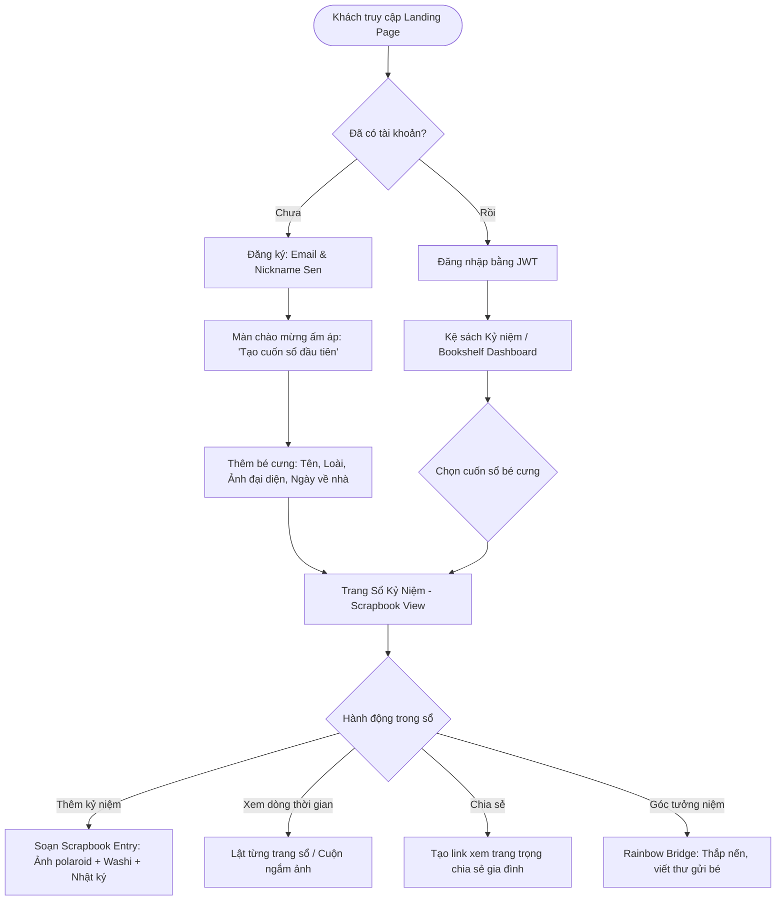

# 🗺️ 02 — USER FLOW & JOURNEY MAP
**Dự án:** PetMemory  
**Phong cách:** Cozy Scrapbook Experience  

---

## 1. Bản đồ luồng người dùng tổng thể (Master Flowchart)

---

## 2. Chi tiết các luồng hành trình (Detailed Journeys)

### 🌿 Luồng 1: Khởi tạo hồ sơ bé cưng (Pet Onboarding Journey)
1. **Lời mở đầu:** Khi đăng nhập lần đầu, thay vì hiển thị form đăng ký khô cứng, PetMemory hiển thị lời chào: *"Chào mừng Sen đến với góc nhỏ yêu thương. Bé cưng của bạn tên là gì thế?"*.
2. **Nhập thông tin:**
   - Đặt tên bé + Chọn icon loài (chó, mèo, thỏ,...).
   - Chọn ngày đón bé về nhà (Gotcha Day) — hệ thống tự tính: *"Hôm nay là ngày thứ X bé đồng hành cùng bạn"*.
   - Upload ảnh đại diện tròn có viền chỉ khâu hoặc ghim gỗ vintage.
3. **Hoàn tất:** Cuốn sổ tay ảo xuất hiện trên "kệ gỗ" với tên của bé được khắc nhũ vàng trên bìa da/vải nỉ.

---

### 📸 Luồng 2: Tạo trang kỷ niệm Scrapbook (Create Memory Entry)
1. **Mở trình soạn thảo:** Nhấn nút bấm hình chiếc ghim cài hoặc nút tem dán *"Dán thêm kỷ niệm"*.
2. **Chọn ảnh:**
   - Người dùng tải 1 hoặc nhiều ảnh của bé.
   - Chọn style khung ảnh: `Polaroid Classic`, `Vintage Film 35mm`, `Bo góc xé giấy dán`.
3. **Thêm chất xúc tác cảm xúc (Emotion Decor):**
   - Chọn màu băng dính Washi Tape (vàng mù tạt, xanh matcha, hoa cúc nhỏ).
   - Đặt sticker vẽ tay (dấu chân mờ, khúc xương, cá hộp, tim đập thình thịch).
4. **Ghi lại câu chuyện:**
   - Nhập tiêu đề ngắn (vd: "Buổi chiều đầu tiên ngủ say trong lòng Sen").
   - Viết vài dòng nhật ký với phông chữ bút máy mềm mại.
   - Tùy chọn: Chọn tệp ghi âm tiếng gừ gừ (purr) hoặc sủa mừng rỡ.
5. **Lưu trang:** Kỷ niệm bay nhẹ nhàng vào trang sổ với âm thanh sột soạt của giấy mộc.

---

### 📖 Luồng 3: Trải nghiệm lật sổ kỷ niệm (Scrapbook Reading Flow)
1. **Vào cuốn sổ:** Người dùng nhấp vào cuốn sổ của bé trên giá sách.
2. **Giao diện 2 trang mở (Spread View):**
   - Bên trái: Ảnh chụp kỷ niệm đính kèm washi tape và ngày tháng viết tay.
   - Bên phải: Dòng tâm sự, nhật ký và tem cột mốc.
3. **Tương tác:**
   - Kéo/vuốt góc trang giấy để lật sang trang tiếp theo (Page Flip hiệu ứng 3D mượt mà).
   - Nhấp vào ảnh Polaroid để phóng to ngắm chi tiết bức ảnh.
   - Bấm nút phát để nghe lại đoạn âm thanh gắn liền với ngày hôm đó.

---

### 🌈 Luồng 4: Góc tưởng niệm Cầu Cầu Vồng (Rainbow Bridge Memorial)
1. **Tôn trọng & Tinh tế:** Khi người dùng chuyển trạng thái bé sang Cầu Cầu Vồng, hệ thống không hiển thị thông báo lỗi hay trạng thái thô thiển, mà mở ra lời chia buồn chân thành cùng bản hòa tấu piano êm đềm (tùy chọn bật/tắt).
2. **Góc thắp nến:**
   - Người dùng chạm vào ngọn nến kỹ thuật số để thắp sáng cho bé.
   - Ngọn lửa nến bập bùng nhẹ nhàng, ghi lại dòng chữ: *"Ngọn nến này được thắp bởi Sen hôm nay để soi lối bé dạo chơi trên thảo nguyên cầu vồng"*.
3. **Viết thư gửi qua cầu vồng (Letter to Heaven):**
   - Viết những lời tâm sự giấu kín gửi cho bé.
   - Nhấn "Gửi gắm yêu thương", lá thư được gấp lại thành phong bì có sáp niêm phong, lưu trong hòm thư vĩnh cửu.
